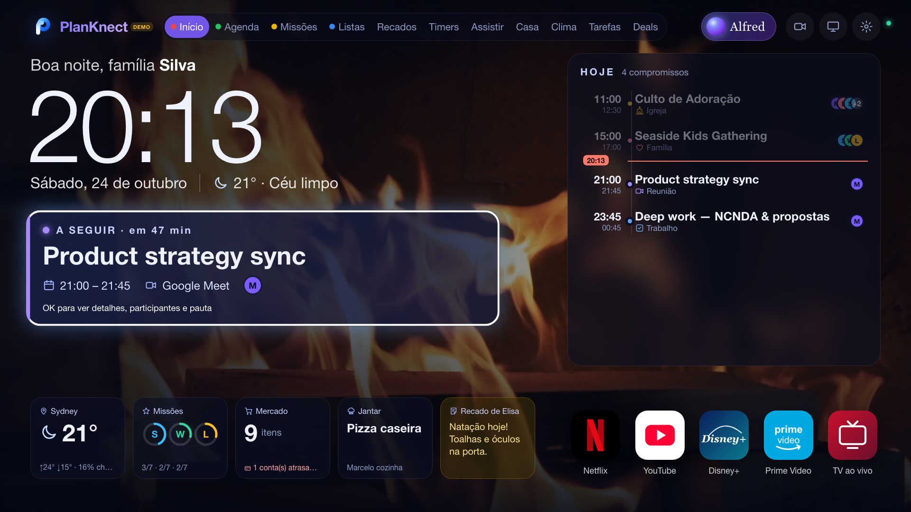
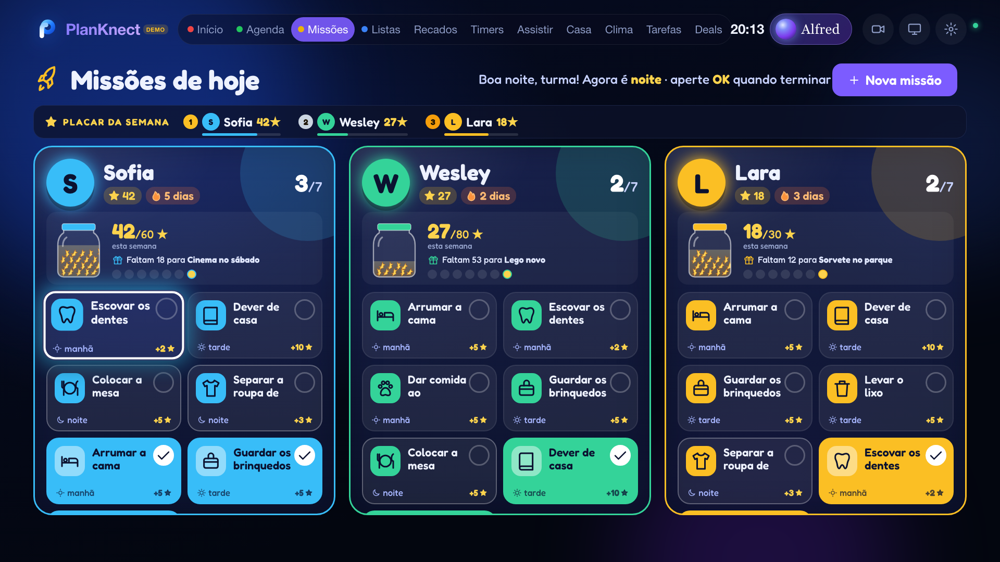
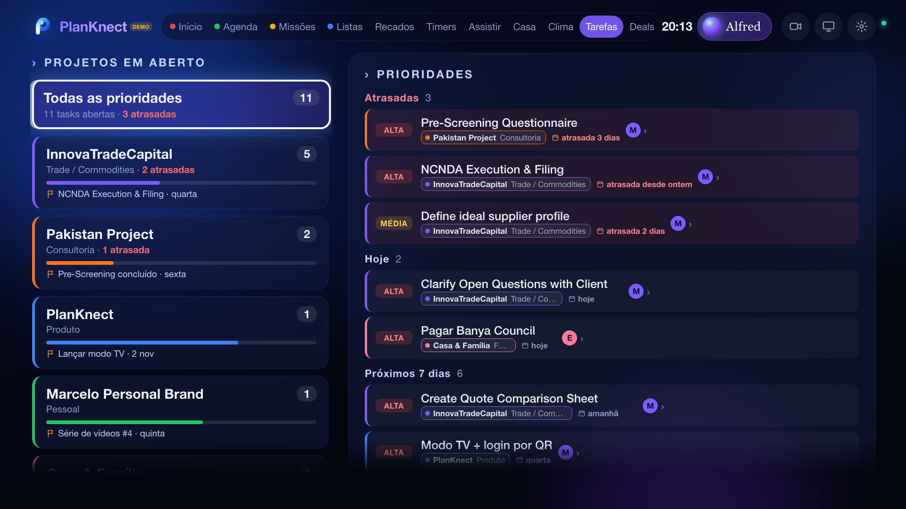
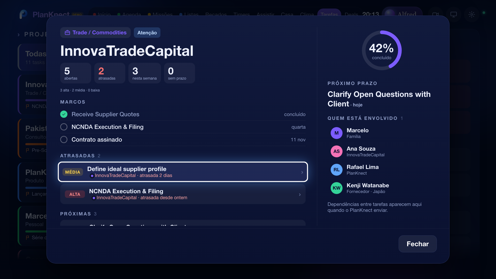
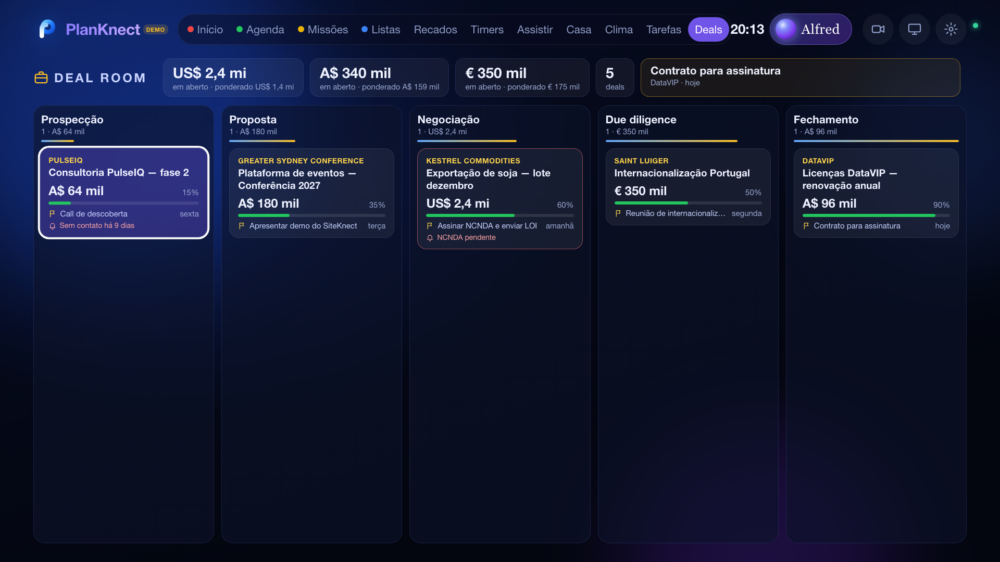
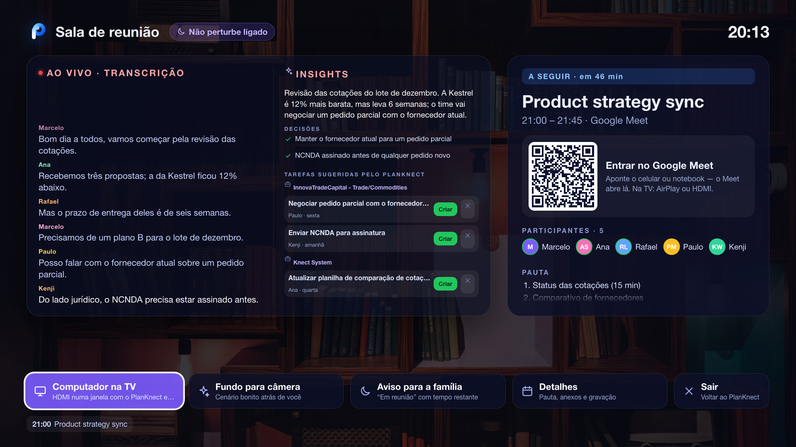
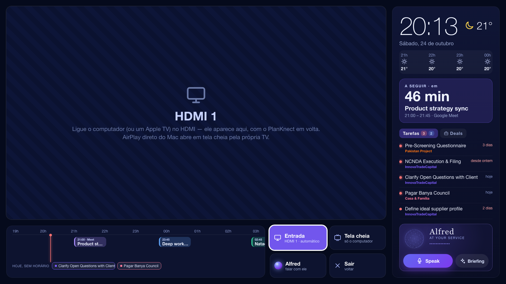
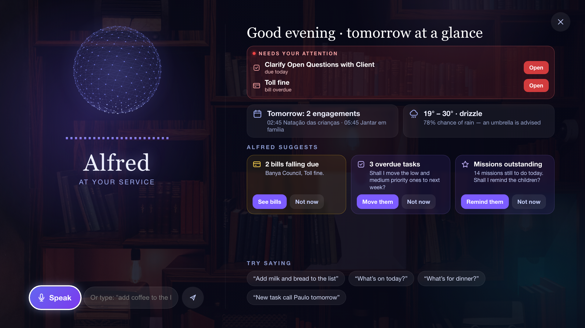

# Manual de uso

## Topo da TV

Abas: **Início · Agenda · Missões · Listas · Recados · Timers · Assistir · Casa · Clima · Tarefas · Deals**. À direita ficam o **Alfred**, a **Sala de reunião** (câmera), o **Modo Computador** (monitor) e os **Ajustes**. O nome de cada botão aparece quando o foco passa por ele.

## Início

Relógio, próximo compromisso (OK abre o detalhe), agenda de hoje, cartões de clima, missões, mercado, jantar e recado, e os apps de streaming.

## Missões das crianças

- OK numa missão **envia para aprovação**. Ela fica amarela, com “aguardando aprovação”. Um adulto aprova no PlanKnect, e só então os pontos entram.
- **Pote de estrelas:** enche com os pontos da semana e mostra quanto falta para o prêmio. A bolinha de cada dia acende quando houve missão feita.
- **Nova missão:** escolha a criança, a repetição (todo dia, dias de semana, só hoje) e as estrelas.

## Tarefas e projetos

- À esquerda ficam os projetos, com cor, atrasadas e o próximo prazo. À direita, as prioridades: atrasadas, hoje, 7 dias e depois.
- Cada tarefa mostra o **projeto (cor) e a organização**, o status, o prazo e o responsável.
- **Detalhe da tarefa:** descrição, subtarefas, último comentário, outras tarefas do projeto, QR para abrir no celular, e Concluir, Em andamento e Adiar.
- **Detalhe do projeto:** saúde (no prazo, atenção ou em risco), números, marcos, em andamento, atrasadas, próximas, pessoas e dependências.

## Deals (Deal Room)

Funil por estágio, total em aberto e ponderado, próximo passo em destaque e alerta de risco ou de deal parado. O detalhe mostra estágios, próximo passo, documentos, atividade, contatos e tarefas ligadas.

## Sala de reunião

- Reunião atual ou próxima, com contagem regressiva, QR do Meet, participantes e pauta.
- **Entrar no computador:** abre o Meet no computador ligado à TV e mostra pelo HDMI. Precisa do `agent/computer-helper.js`.
- **Knect Meeting:** transcrição ao vivo, resumo, decisões e **tarefas sugeridas por projeto**, com **Criar**.
- **Fundo para câmera** (cenários com foto ou vídeo) e **Aviso para a família** (“em reunião” com tempo restante).
- O aviso de reunião aparece por cima de tudo, com timer, **Entrar**, Adiar e Fechar.

## Modo Computador (Samsung)

- O HDMI fica numa janela. Em volta: relógio, clima das próximas horas, próxima reunião (com QR do Meet e Entrar), **Tarefas | Deals** e o Alfred.
- **Linha do tempo** até o fim do dia, com compromissos, tarefas com horário e “hoje, sem horário”. Tudo abre com OK.
- **Entrada:** escolha o HDMI do computador (fica salvo). **Tela cheia:** só o computador. Voltar devolve o PlanKnect.

## Alfred

- Resumo do dia, **precisa de você**, sugestões e “experimente dizer”.
- **Fale ou digite:** “adiciona leite e pão na lista”, “o que tem hoje?”, “nova tarefa ligar para o Paulo amanhã”, “lembra que a Sofia tem natação às terças”.
- O PlanKnect **propõe** e você **Confirma** ou **Cancela**. Nada é gravado antes disso.
- Voz britânica do PlanKnect (Ajustes › Alfred: idioma, voz, fundo, visual).

## Nest Hub
| | |
|---|---|
|  |  |

Toque nas abas de baixo. **Moldura** mostra as fotos da família com relógio, clima e a agenda de cada um. O botão de sincronizar atualiza na hora.

## Ajustes úteis (TV)
- **Alfred:** idioma das respostas, idioma em que você fala, voz (PlanKnect ou TV), fundo, teste de voz.
- **Computador na TV:** em qual HDMI está o computador.
- **Modo reunião:** entrar sozinho, estilo, cenário.
- **Avisos:** antecedência da reunião e tempo do adiar.
- **Tela:** fundo da tela inicial, modo ambiente e moldura.
