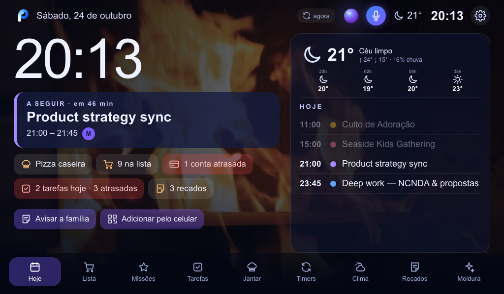
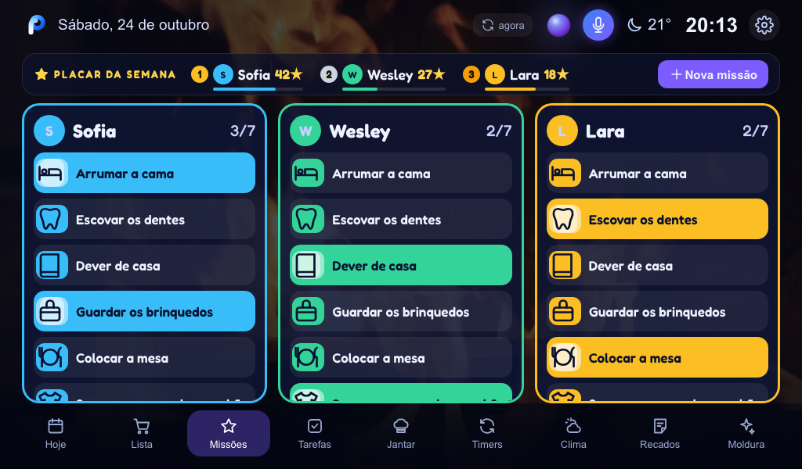
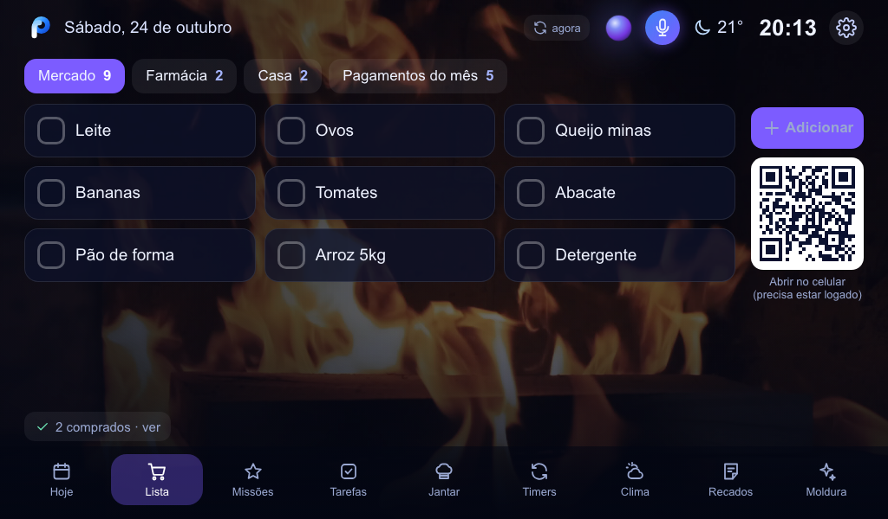
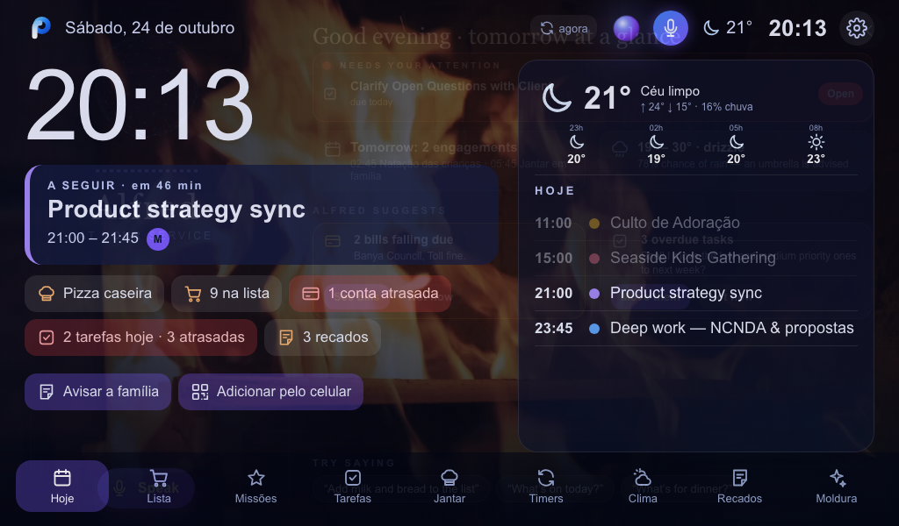

# PlanKnect no Google Nest Hub

O Nest Hub não instala apps. O PlanKnect abre nele por **Cast**: o Hub carrega a versão hospedada em
`https://mmbussacarini.github.io/PlanKnect/app/nest-hub.html`. Não depende de nenhum computador ligado.



## Abrir (qualquer pessoa da casa)

1. No **Chrome** do celular Android ou do computador, na mesma rede Wi-Fi do Hub, abra:
   **[https://mmbussacarini.github.io/PlanKnect/google-nest/](https://mmbussacarini.github.io/PlanKnect/google-nest/)**
2. Toque em **Mostrar no Nest Hub** e escolha o Hub (ex.: “Kitchen Display”).
3. Na primeira vez, o Hub mostra um **QR**. Aprove pelo celular em planknect.com.

Dica: no Android, adicione a página à tela inicial (menu do Chrome › “Adicionar à tela inicial”). Vira um botão “PlanKnect no Hub”.

Para tirar da tela: “Ok Google, parar”, ou deslize para baixo no Hub.

> No iPhone, o Safari não tem Cast. Use o Chrome de um computador ou a opção “sempre ligado” abaixo.

## Manter sempre ligado

Num Mac (ou Linux, ou Raspberry Pi) que fique ligado em casa:

```bash
cd google-nest/keepalive
./install.sh "Kitchen Display"        # nome do Hub no app Google Home
```

A cada 2 minutos, das 6h às 22h, ele abre o PlanKnect **se o Hub estiver parado** (tela inicial ou moldura de fotos). Nunca interrompe música, YouTube ou chamadas. Para mudar o horário: `PK_FROM=7 PK_TO=21 ./install.sh "Kitchen Display"`. Para desligar: `./install.sh --uninstall`.

Manual (uma vez): `pip install pychromecast && python3 cast_hub.py "Kitchen Display" https://mmbussacarini.github.io/PlanKnect/app/nest-hub.html --force`

## Como funciona

- O receptor é o **DashCast** (receptor público de Cast que mostra uma página web). Quando o PlanKnect registrar um receptor próprio no Google Cast Console, basta trocar o id (`--receiver=<id>`).
- Depois de conectado, o Hub atualiza os dados a cada 15 segundos e recarrega sozinho quando sai versão nova.
- O microfone do Hub não é liberado para páginas Cast. Para falar com o Alfred, use a TV ou o celular.

## Telas

| | |
|---|---|
|  |  |
|  |  |
